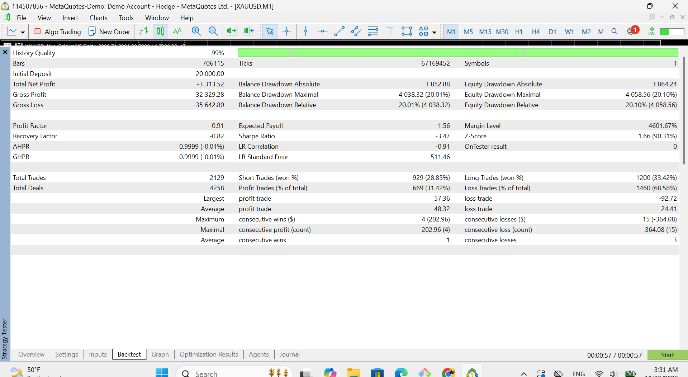
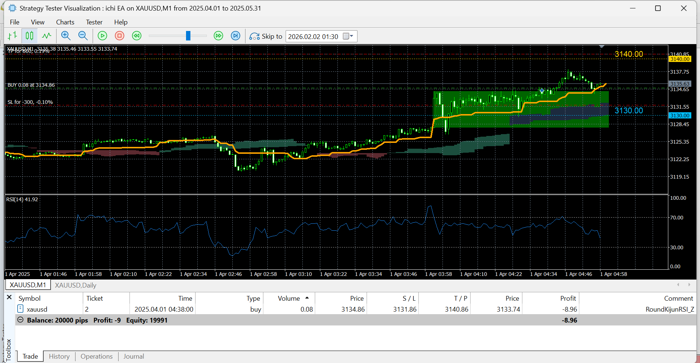

# Strategy Claim Audit: I Tested a "Mechanical Strategy" on Gold

**I took a publicly promoted XAUUSD strategy, built it as an Expert Advisor exactly as it was presented, and tested it on two years of tick data. This is what happened.**

> Not financial advice. This repo is about how to test a claim, not about telling anyone what to trade.

---

## Why I did this

I attended a webinar by a well-known trading coach. He presented a "mechanical strategy" for gold, and it was described as something close to miraculous: simple rules, clear logic, and a strong promise of profit. He also insisted it should be run on the 1-minute chart.

The rules were clear enough to code, so I coded them.

I did this because I have a suspicion about a lot of what is promoted online. Many people with hundreds of thousands of followers sell strategies that look simple and convincing. If those claims don't hold up, the people who follow them lose money and time, and they end up further from a real trading profession, not closer to it.

So I asked one simple question: **if I build this strategy exactly as it was presented, does the claim hold up?**

I'm not attacking anyone. I don't name the coach and I make no guesses about anyone's intentions. I'm only checking written rules against data. Anyone can repeat this, and I hope more people check big claims before trusting them.

---

## The claim I tested

The strategy was presented as a profitable mechanical system for XAUUSD on the 1-minute chart. I tested the written rules as given, with nothing added by me.

---

## The strategy, in simple words

The EA trades gold (XAUUSD) on the **1-minute chart**. It watches **round price levels** every $10 (for example 3,510 or 3,520). When price closes beyond one of them, it considers a trade, but only if all these agree:

- The price is on the right side of the **Kijun line** and the **Ichimoku cloud** (trend filter).
- **RSI** is not too extreme. A buy is skipped above 66 and a sell is skipped below 33.
- The close is no more than **$5** beyond the round level.
- The level is not currently banned (see below).

The other rules:

- **Stop loss:** 30 pips. **Take profit:** 55 pips. Fixed risk per trade.
- **Zones:** if only RSI blocks a trade, the EA remembers that price area as a "zone" and may enter later when price closes beyond it.
- **Level bans:** if trades from the same zone hit the stop twice in a row, that level is banned until price moves away.
- **Daily limits:** an optional daily loss limit and daily profit target.

The EA only looks at **closed bars**, so it never uses future data.

---

## How I tested it

| Setting | Value |
|---|---|
| Symbol / timeframe | XAUUSD, 1 minute (as the claim says) |
| Period | 2024 to 2025 |
| Data | Tick data, 67,169,452 ticks, 706,115 bars, history quality 99% |
| Platform | MetaTrader 5 Strategy Tester, MetaQuotes demo server, hedging account |
| Initial deposit | $20,000 |
| EA | `RoundLevel_Kijun_RSI_EA_v7.mq5`, all rules from the webinar |

### An honest note about my process

During development I ran earlier backtests. In those, the 5-minute chart looked slightly better than the 1-minute chart. A small difference like that is easy to get by luck, especially when you look at several options and pick the best, so I do **not** use it as a result. The result below is the 1-minute test, exactly as the claim was made. Because I had seen earlier runs, this is one full-period test and not a clean, never-seen-before test.

---

## Results




| Metric | Result |
|---|---|
| Total net profit | **-$3,313.52** (-16.6% of $20,000) |
| Gross profit / gross loss | $32,329.28 / -$35,642.80 |
| Profit factor | **0.91** |
| Expected payoff per trade | **-$1.56** |
| Total trades | 2,129 (1,200 long, 929 short) |
| Win rate | **31.42%** (669 wins, 1,460 losses) |
| Win rate, long / short | 33.42% / 28.85% |
| Average win / average loss | $48.32 / -$24.41 |
| Largest win / largest loss | $57.36 / -$92.72 |
| Max consecutive losses | 15 (-$364.08) |
| Max equity drawdown | $4,058.56 (20.10%) |
| Recovery factor | -0.82 |

### Reading the numbers in plain words

- **The strategy lost money.** Over about two years and 2,129 trades, the account went down by 16.6%.
- **Win rate versus break-even.** The average win ($48.32) is about twice the average loss ($24.41). With that ratio, the strategy needs to win about **33.6%** of its trades just to break even. It won **31.4%**. A gap of two percentage points looks tiny, but across 2,129 trades it adds up to a real loss.
- **Longs did better than shorts**, but even the long side (33.4%) sat just under break-even.
- **It is not a dramatic failure, and that is the point.** It doesn't blow up the account. It bleeds slowly, with a drawdown around 20% and streaks of up to 15 losses in a row. A system like this can look fine for weeks and still lose over time. This is exactly the kind of strategy that a few good-looking screenshots can sell.

### A quick statistical check

Using only the summary numbers above (win rate, average win, average loss, number of trades), I estimated the average trade at about **-$1.56**, with a rough 95% range of about **-$3.0 to -$0.1**.

This is a rough estimate. It treats every win and loss as the average size, so the real range is a little wider. The honest reading is: the data leans clearly negative, but the top of the range is close to zero, so I won't claim more than that. A proper bootstrap on the exported trade list gives a more reliable answer, and it is part of the analysis notebook.

---

## What I found

Under these conditions, the strategy **did not show a positive edge**. After two years of tick data on the exact setup that was promoted, the result was a loss, a profit factor below 1, and a win rate under the break-even point. It was not miraculous, and it was not even close to profitable.

---

## What this does not prove

I want to be fair about the limits:

- This is **my implementation** of the written rules. If the original strategy included discretionary decisions that can't be coded, my version may not match it perfectly.
- I tested **one symbol, one timeframe and one period** (XAUUSD, 1 minute, 2024 to 2025). Other periods could look different.
- I tested on a **demo server**. Spread and commission on a live broker may differ, and costs matter a lot with a 30 pip stop.
- I did **not** run a separate out-of-sample test or a full sensitivity study (changing stop and target) in this version.
- Backtests are never a promise about the future, in either direction.

In short: this shows what the written rules did on past data under the conditions above. It says nothing about what the coach does in his own trading.

---

## What I think the lesson is

- A strategy can look simple, convincing and "mechanical" and still have no edge.
- Do the break-even math first. Take the win rate, the average win and the average loss. If you can't write them down, you can't judge a claim.
- Ask for the number of trades, the period, the costs and an out-of-sample test. A few screenshots are not evidence.
- Test before you risk real money. It costs you a weekend. A wrong claim can cost you a lot more.

---

## Repository structure

```
strategy-claim-audit/
├── README.md
├── ea/
│   └── RoundLevel_Kijun_RSI_EA_v7.mq5
├── results/
│   └── trades/             trade list exported from MetaTrader
├── notebooks/
│   └── 01_analysis.ipynb   metrics, bootstrap, charts
├── src/
│   ├── metrics.py
│   └── bootstrap.py
└── docs/images/
    └── backtest_report.png
```

---

## How to reproduce

1. Copy the EA from `ea/` into `MQL5/Experts/` and compile it in MetaEditor.
2. Open the Strategy Tester with the settings from the table above (XAUUSD, M1, 2024 to 2025, tick-based data).
3. Run it, then export the trade list.
4. Run the notebook to recompute the metrics and the bootstrap.

Your numbers may differ slightly depending on your broker's data and costs.

---

## Tech

- **MQL5** (MetaTrader 5): the EA and Strategy Tester runs
- **Python:** Pandas, NumPy, Matplotlib, Jupyter
- **Methods:** break-even analysis, expectancy, drawdown, bootstrap confidence intervals

---

## About me

I'm Amir, a trading systems developer interested in financial markets, data and automation. I would rather publish an honest negative result than a good-looking claim I can't prove.

GitHub: [amir-mirshahi](https://github.com/amir-mirshahi)

---

## Disclaimer

For education and research only. This is not financial advice, and nothing here is a recommendation to buy or sell anything. I'm not affiliated with the person who presented the original strategy, and this repo contains none of their material. Trading carries a high risk of loss.
